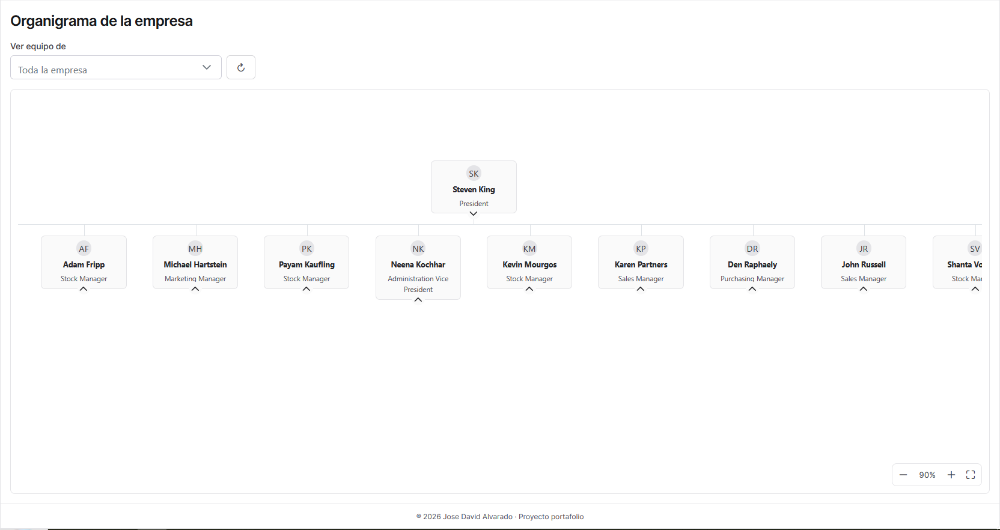
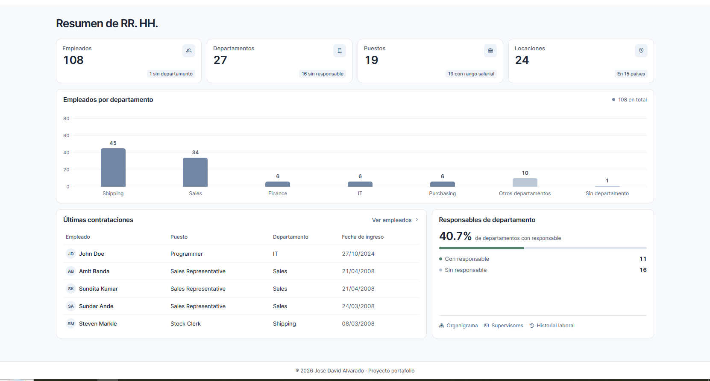
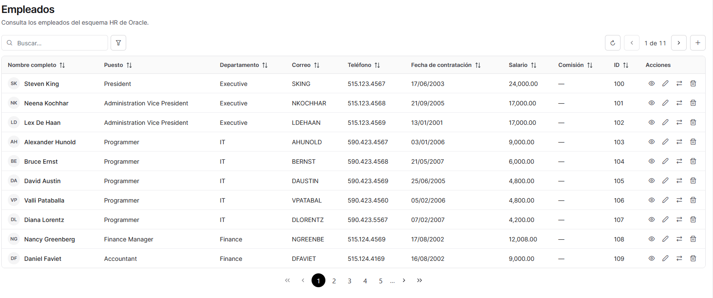
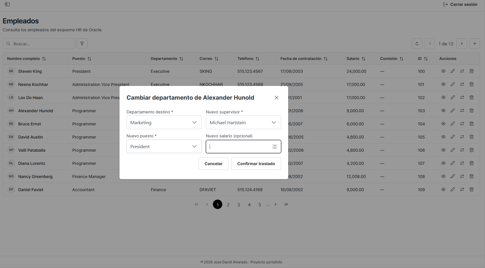
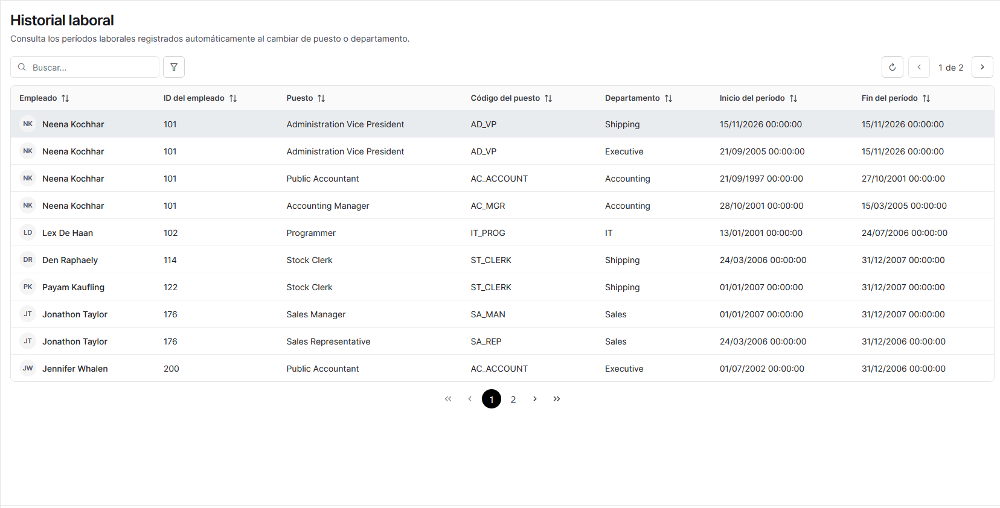

# HR · Gestión de recursos humanos

Aplicación web para administrar empleados, departamentos, puestos y ubicaciones sobre el esquema HR de Oracle. Combina operaciones administrativas con un organigrama interactivo para explorar la estructura de la empresa y las relaciones entre supervisores y subordinados.

El frontend reutiliza tablas y formularios configurables. El backend concentra las consultas, las reglas de negocio y el acceso a Oracle.

[Funciones](#funciones) · [Capturas](#capturas) · [Instalación](#instalación-local) · [Configuración](#configuración) · [Arquitectura](#arquitectura) · [Validación](#validación)


## Funciones

### Organigrama interactivo

Explora la jerarquía completa de la empresa o selecciona un supervisor para consultar su estructura de subordinados.

- Expansión y contracción de ramas.
- Desplazamiento del lienzo mediante arrastre o flechas del teclado.
- Acercamiento y alejamiento mediante la rueda o los controles de zoom.
- Ajuste del diagrama al área visible.
- Identificación de empleados y puestos dentro de los nodos.

### Administración de recursos humanos

| Módulo | Funcionalidad |
| --- | --- |
| Inicio | Totales de empleados, departamentos, puestos y locaciones; distribución por departamento, últimas contrataciones y departamentos con responsable. |
| Empleados | Creación, consulta, edición y eliminación, sujetas a las validaciones del backend. |
| Supervisores | Consulta de relaciones de supervisión y cambio de supervisor. |
| Traslados | Cambio de departamento, supervisor y puesto, con validación del rango salarial del nuevo puesto. |
| Contrataciones coincidentes | Parejas de empleados con la misma fecha de contratación. |
| Departamentos | Gestión de departamentos y cambio de responsable. |
| Puestos | Gestión de puestos y sus salarios mínimo y máximo. |
| Regiones, países y locaciones | Mantenimiento de catálogos geográficos y sus relaciones. |
| Países por región | Cantidad de países registrados en cada región. |
| Historial laboral | Consulta de períodos registrados por la lógica de la base de datos; sin creación manual desde esta vista. |

Las tablas incluyen búsqueda, filtros, ordenamiento, paginación y recarga con Skeleton. Los formularios presentan las relaciones mediante catálogos y comunican los resultados mediante notificaciones toast.

## Capturas

### Organigrama de la empresa

>  Muestra una jerarquía desplegada, nombres legibles y los controles del lienzo.



### Resumen de recursos humanos

>  Inicio con los indicadores y la distribución de empleados.



### Gestión de empleados

> Listado con búsqueda, filtros y acciones.



### Cambio de departamento

> Formulario de traslado con sus catálogos.



### Historial laboral

> Períodos laborales de los empleados.




## Tecnologías

| Capa | Tecnologías del proyecto |
| --- | --- |
| Interfaz | React 19, JavaScript y CSS |
| Componentes | PrimeReact 9.6.5 y PrimeIcons 8 |
| Herramientas del frontend | Vite 8, ESLint y npm |
| Comunicación HTTP | Axios |
| API | ASP.NET Core sobre .NET 10 |
| Persistencia | Entity Framework Core y proveedor Oracle |
| Base de datos | Oracle Database, esquema HR |
| Autenticación | JWT y autorización por roles |
| Pruebas del backend | xUnit y Moq |

Las versiones exactas se consultan en [`package-lock.json`](hr-frontend/package-lock.json) y en el [proyecto de la API](HrApiProject/HrApiProject.csproj).

## Instalación local

### 1. Requisitos

- Git.
- Node.js 22.12 o posterior de la rama 22, o una versión posterior compatible con Vite 8, con npm.
- SDK de .NET 10.
- Una instancia de Oracle accesible con el esquema HR y sus objetos cargados.
- SQL Developer u otro cliente Oracle para preparar y verificar la base de datos.

Comprueba las herramientas instaladas:

```shell
git --version
node --version
npm --version
dotnet --list-sdks
```

### 2. Clona el repositorio

```shell
git clone https://github.com/JoseDavid17/HrApiProject.git
cd HrApiProject
```

Los siguientes comandos parten de esta carpeta raíz, donde se encuentra `HrApiProject.slnx`.

### 3. Prepara Oracle

La aplicación espera una base existente. Antes de ejecutar la API:

1. Crea o utiliza un usuario propietario del esquema HR.
2. Importa las tablas, restricciones, datos y objetos de base de datos requeridos por el proyecto.
3. Comprueba las tablas `EMPLOYEES`, `DEPARTMENTS`, `JOBS`, `JOB_HISTORY`, `REGIONS`, `COUNTRIES` y `LOCATIONS`.
4. Verifica los triggers y procedimientos que alimentan el historial laboral, especialmente antes de probar cambios de puesto o departamento.
5. Prueba la conexión con ese usuario desde tu cliente Oracle.

**El repositorio revisado no incluye scripts `.sql` para instalar el esquema.** Debes disponer de una exportación compatible. No ejecutes migraciones esperando que creen los triggers o procedimientos de una base existente.

Para una base en Oracle Cloud, configura también el acceso de red y los requisitos TLS o wallet que correspondan a tu instancia.

### 4. Configura los secretos de la API

Desde la raíz del repositorio, guarda los valores locales mediante User Secrets:

```shell
dotnet user-secrets set "ConnectionStrings:OracleDB" "User Id=HR;Password=TU_PASSWORD_LOCAL;Data Source=localhost:1521/TU_SERVICIO" --project HrApiProject
dotnet user-secrets set "JwtSettings:SecretKey" "REEMPLAZAR_POR_UNA_CLAVE_ALEATORIA_DE_AL_MENOS_32_BYTES" --project HrApiProject
dotnet user-secrets set "JwtSettings:Issuer" "HrApi.Local" --project HrApiProject
dotnet user-secrets set "JwtSettings:Audience" "HrFrontend.Local" --project HrApiProject
dotnet user-secrets set "JwtSettings:ExpirationMinutes" "60" --project HrApiProject
```

Reemplaza todos los valores de ejemplo. `TU_SERVICIO` debe ser el servicio real de Oracle, no necesariamente el nombre del usuario o del esquema. La clave JWT debe generarse aleatoriamente; el texto de ejemplo no es una clave utilizable.

El proyecto ya tiene un `UserSecretsId`. User Secrets evita guardar estos valores en Git, pero no es un almacén cifrado de secretos de producción.

### 5. Ejecuta el backend

```shell
dotnet restore HrApiProject.slnx
dotnet dev-certs https --trust
dotnet run --project HrApiProject --launch-profile https
```

Con el perfil `https` del repositorio:

| Recurso | Dirección local |
| --- | --- |
| URL base de la API | `https://localhost:7078/api` |
| Swagger UI, en desarrollo | `https://localhost:7078/` |
| Documento OpenAPI, en desarrollo | `https://localhost:7078/openapi/v1.json` |

Mantén esta terminal abierta. La API utiliza el entorno `Development` con ese perfil.


### 6. Configura y ejecuta el frontend

Abre otra terminal y, desde la raíz del repositorio, ejecuta:

```shell
cd hr-frontend
npm ci
```

Crea un archivo `.env.local` dentro de `hr-frontend/` con este contenido:

```dotenv
VITE_HR_API_URL=https://localhost:7078/api
```

Inicia la aplicación:

```shell
npm run dev
```

Abre `http://localhost:5173` y mantén ambas terminales abiertas. Si cambias `.env.local`, reinicia Vite. El backend permite ese origen local mediante CORS; si utilizas otro puerto, debes autorizarlo explícitamente en la API.

### 7. Inicia sesión y explora

Utiliza estas credenciales de demostración para recorrer los módulos administrativos:

| Campo | Valor |
| --- | --- |
| Usuario | `admin` |
| Contraseña | `12345` |
| Rol | `Admin` |

Estas credenciales corresponden a la cuenta de prueba definida en [`AuthController`](HrApiProject/Controllers/AuthController.cs).

Esta autenticación es demostrativa: no incluye registro de usuarios, recuperación de contraseña ni gestión de identidades persistidas. Antes de utilizar datos reales, sustituye las cuentas embebidas por un mecanismo de autenticación adecuado.

Recorrido sugerido: **Inicio → Empleados → Organigrama → Supervisores → Historial laboral**.

## Configuración

| Clave | Uso | Dónde configurarla |
| --- | --- | --- |
| `VITE_HR_API_URL` | URL de la API, incluyendo `/api`. | `.env.local` o variables del build del frontend. |
| `ConnectionStrings:OracleDB` | Conexión a Oracle. | User Secrets en desarrollo; secretos del proveedor en producción. |
| `JwtSettings:SecretKey` | Firma de los tokens. | User Secrets o secretos del proveedor. |
| `JwtSettings:Issuer` | Emisor esperado del JWT. | Configuración de la API. |
| `JwtSettings:Audience` | Audiencia esperada del JWT. | Configuración de la API. |
| `JwtSettings:ExpirationMinutes` | Duración de la sesión emitida por la API. | Configuración de la API. |
| `ReverseProxy:KnownProxies` | Lista de IP de proxies confiables. | Configuración del entorno, una vez verificadas las direcciones. |

En variables de entorno del backend, sustituye `:` por `__`, por ejemplo `ConnectionStrings__OracleDB`. Para un elemento de la lista de proxies, utiliza `ReverseProxy__KnownProxies__0`.

Las variables `VITE_*` forman parte del código que recibe el navegador: **no contienen contraseñas, cadenas de conexión ni claves JWT**.

### Limitación de solicitudes

| Política | Configuración actual |
| --- | --- |
| Login en desarrollo | 5 solicitudes por minuto por IP. |
| Login fuera de desarrollo | 5 solicitudes por minuto compartidas por instancia, para la demostración. |
| General | Token Bucket por usuario autenticado: capacidad de 60 y reposición de 10 tokens cada 10 segundos. |

El rechazo devuelve `429 Too Many Requests`, un mensaje JSON y `Retry-After` cuando el limitador proporciona ese dato. El login compartido puede hacer que un visitante consuma el cupo de los demás. Los contadores están en memoria y no se comparten entre instancias.

## Arquitectura

| Ubicación, desde la raíz | Responsabilidad |
| --- | --- |
| `hr-frontend/src/layout/` | Layout, navegación y estructura visual. |
| `hr-frontend/src/components/` | Componentes compartidos, incluida `CrudTable`. |
| `hr-frontend/src/pages/hrModules.js` | Configuración de módulos, campos, columnas, catálogos y acciones. |
| `hr-frontend/src/pages/HrModulePage.jsx` | Comportamiento común de listados y formularios. |
| `hr-frontend/src/pages/hrApi.js` | Cliente HTTP, sesión y operaciones reutilizables. |
| `hr-frontend/src/pages/OrganizationChartPage.jsx` | Consulta y navegación del organigrama. |
| `HrApiProject/Controllers/` | Contratos HTTP, rutas y autorización. |
| `HrApiProject/Services/` | Contratos de servicios, consultas y reglas de negocio. |
| `HrApiProject/DTOs/` | Modelos de entrada y salida de la API. |
| `HrApiProject/Domain/` | Entidades del dominio. |
| `HrApiProject/Data/` | Contexto de Entity Framework Core. |
| `HrApiProject/Middlewares/` | Manejo transversal de errores. |
| `HrApiProyect.Tests/` | Pruebas del backend. |

Para añadir un módulo que siga el patrón existente, define su configuración en `hrModules.js` y su entrada de navegación en `HrLayout.jsx`. Reutiliza la tabla y los formularios comunes; reserva vistas propias para interacciones que lo requieran, como el lienzo del organigrama.

Las rutas del frontend utilizan hash, por ejemplo `/#/empleados/organigrama`. Las rutas HTTP de la API mantienen el prefijo `/api`.

## Validación

Desde `hr-frontend/`:

```shell
npm run lint
npm run build
npm run preview
```

`preview` permite inspeccionar el build local; utiliza el puerto indicado por Vite. Si consumes la API desde ese origen, debes permitirlo también en CORS. No sustituye un servidor de producción.

Desde la raíz del repositorio:

```shell
dotnet test HrApiProyect.Tests/HrApiProyect.Tests.csproj
```

Las pruebas existentes no sustituyen la verificación de las operaciones sobre Oracle, sus restricciones y sus triggers.

## Problemas frecuentes

| Síntoma | Qué revisar |
| --- | --- |
| Error de certificado en localhost | Confía en el certificado de desarrollo con `dotnet dev-certs https --trust` y abre la API en el navegador. |
| Error de CORS | El origen completo del frontend, incluido el puerto, debe estar autorizado en la API. |
| `401 Unauthorized` | Credenciales, expiración del token y configuración de emisor, audiencia y firma. |
| `403 Forbidden` | El rol de la cuenta no permite ejecutar la operación solicitada. |
| `429 Too Many Requests` | Espera el tiempo indicado por `Retry-After`; el login de demostración comparte cupo en producción. |
| Timeout o rechazo de Oracle | Servicio, credenciales, conectividad, estado de la instancia y reglas de acceso. |
| Error al cambiar puesto o departamento | Revisa las reglas de negocio y los triggers del historial; no desactives restricciones para ocultar el error. |
| Cambiar la URL de API no tiene efecto | Reinicia Vite en desarrollo o reconstruye el frontend desplegado. |

## Autor

[Jose Alvarado ](https://github.com/JoseDavid17)

Proyecto de aprendizaje y demostración de una aplicación de recursos humanos con React, ASP.NET Core y Oracle.

